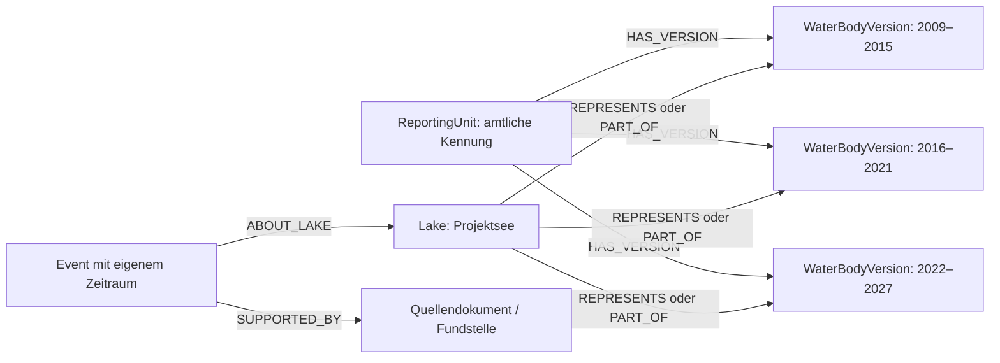

# SOLVE: 33 Seen, WRRL-Berichtsstände und temporaler Knowledge Graph

Dieses eigenständige Projekt verbindet die 490 recherchierten Event-Einträge mit amtlichen WRRL-Berichtsständen. PostgreSQL/PostGIS ist die strukturierte Datenbasis; Neo4j wird ausschließlich aus dem validierten PostgreSQL-Snapshot aufgebaut. Die bestehenden Prototyp-Datenbanken werden nicht verwendet oder verändert.

## Enthaltener Datenstand

Abruf: **31. Oktober 2026**. Die drei öffentlich zugänglichen WISE-WFD-Berichtszyklen wurden für die 33 Projektseen abgefragt. Die EEA-Dienste bezeichnen sie als WFD2010, WFD2016 und WFD2022.

| Berichtszyklus | Dienstjahr | Wasserkörper-Versionen | Messstellen-Versionen | Wasserkörper mit Qualitätskomponenten |
|---|---:|---:|---:|---:|
| 2009–2015 | 2010 | 33 | 28 | 33 |
| 2016–2021 | 2016 | 31 | 181 | 24 |
| 2022–2027 | 2022 | 31 | 37 | 22 |

Zusammen: **95 Wasserkörper-Versionen, 246 Messstellen-Versionen, 1.897 Bewertungs-/Qualitätskomponenten-Einträge**, 33 Projektseen und 490 Event-Einträge mit 506 Quellenbelegen aus 65 Dokumenten. Die 1.897 Einträge enthalten auch ausdrücklich gemeldete Leer-/Unbekannt-Kennzeichnungen; sie sind keine 1.897 positiven Zustandsbefunde und keine Einzelmesswerte.

`data/prepared/Zuordnung_33_Seen.csv` enthält 99 nachvollziehbare Zuordnungen: einmal je See und Berichtszyklus. Die Zuordnungen sind quellenbasiert geprüft; der fachliche Human Review der Event-Aussagen bleibt offen. `data/prepared/bundle.json` ist die vollständige, transportierbare Importdatei.

## Woher die Daten stammen

Der direkte nationale BfG-Download lieferte in dieser Umgebung HTTP 403. Verwendet wurde deshalb die **amtliche Veröffentlichung der deutschen Meldedaten durch die Europäische Umweltagentur (EEA/WISE)**. Dies ist ausdrücklich kein direkter oder unveränderter historischer WasserBLIcK-Export. Es wurde kein Zugriff auf beschränkte ursprüngliche CDR-Dateien versucht. Die zunächst geprüfte Esri-Kopie wird im endgültigen Import nicht verwendet.

- [EEA WISE-WFD-Dienste](https://water.discomap.eea.europa.eu/arcgis/rest/services/WISE_WFD)
- [BfG/WasserBLIcK: Definition der Messstellenattribute](https://www.wasserblick.net/servlet/is/192028/wfd_swstn_de.html?command=downloadContent&filename=wfd_swstn_de.html)
- [EEA-Datensatz und Dokumentation](https://www.eea.europa.eu/en/datahub/datahubitem-view/5ee22fbc-fa6c-49a0-836c-9cbd202eaff9)
- [EEA-Technikbericht v1.9, September 2025](https://sdi.eea.europa.eu/catalogue/api/records/6b55632c-63df-4542-97f0-363dfb6d3431/attachments/WISE_WFD_ReferenceSpatialDataSets_2025-09%20v1.9.pdf)

Die Dienstmetadaten nennen CC BY 4.0. Die Attribution lautet: European Environment Agency, WISE WFD Reference Spatial Datasets, deutsche Meldedaten der zuständigen Behörden/BfG, Abruf 31.10.2026. Die jeweilige Lizenzangabe und der genaue Abrufweg liegen im Snapshot. Bei den Event-Quellen gelten die jeweiligen Rechte der Originalherausgeber.

Jeder Abruf speichert URL, Zeitpunkt, SHA-256, Originalantwort und Felddefinitionen. Anzahl und OBJECTIDs werden vor/nach der Abfrage verglichen, damit eine abgeschnittene API-Antwort nicht als vollständig gilt. Rohwerte wie `Unknown`, `Unpopulated`, `Inapplicable`, die Zeichenkette `None` und JSON `null` bleiben unterscheidbar.

## Grenzen des Bestands

- Die Bestandsaufnahme 2004 ist historisch belegt, aber es wurde kein verifizierbarer, öffentlich abrufbarer maschinenlesbarer Ausschnitt für diese 33 Seen gefunden. Diese Lücke ist dokumentiert; 2010 wurde nicht als 2004 ausgegeben.
- Die EEA konsolidiert ältere Referenzgeometrien teilweise mit späteren Geometrien. Ein Knoten des ersten Berichtszyklus ist **keine Rekonstruktion der damaligen Uferlinie**. Auch Messstellenmetadaten können später revidiert sein. Versions-/Lebenszyklusdaten sind kein nachgewiesener Messbeginn.
- Die Dienste liefern Wasserkörper, Geometrien, gemeldete Bewertungen und Messstellenmetadaten. **Messwert-Zeitreihen aus FGG Elbe, Wasserrechte und APW-Daten sind nicht Bestandteil dieses Abrufs.** Sie benötigen eigene Importe und eine zusätzliche Stations-/Belegzuordnung.
- Weniger gemeldete Messstellen in einem Dienstjahr beweisen keine Abnahme der tatsächlichen Überwachung.
- Die ursprünglichen Event-PDFs sind nicht im Paket. Die Quellen-URLs bleiben erhalten. Lokale Pfade in den unveränderten Event-Metadaten dokumentieren die ursprüngliche Arbeitsumgebung und sind auf dem Linux-Server nicht automatisch gültig.

## Temporales Modell



Berichtszeitraum, tatsächlicher Bewertungszeitraum, Event-Zeitpunkt und Abrufzeit sind getrennt. Fehlende Tagesdaten werden nicht erfunden. Die Versionen stehen parallel; ein neuer Berichtsstand überschreibt den alten nicht. Gleiche amtliche Kennungen gruppieren Versionen, garantieren aber keine unveränderte Geometrie oder fachliche Abgrenzung.

Die Projektseen bleiben eigene Entitäten. Beispiel Rappbode:

- 2010: Hauptsperre `DELW_DEST_SAL17OW14-00`, Vorsperre Rappbode `DEST_SAL17OW13-00`, Vorsperre Hassel `DEST_SAL17OW18-00`.
- Die beiden Vorsperren sind im historischen Bericht als RW und repräsentative Punkte gemeldet. Diese Originalkategorie und Punktgeometrie bleiben erhalten.
- 2016/2022: alle drei Projektseen sind Teile des gemeinsamen Wasserkörpers `DELW_DEST_SAL17OW14-00`.

Die Beziehung Event → See → Wasserkörper-Version ist eine **kontextuelle Zuordnung**. Sie beweist weder, dass das Event in diesem Berichtszeitraum stattfand, noch dass eine bestimmte Messstelle oder Messung das Event belegt. Dafür werden keine erfundenen Fremdschlüssel erzeugt. Ein Code-Match bestätigt auch nicht automatisch die sachliche Richtigkeit der Event-Aussage.

## Start auf dem Linux-Server

Das ZIP vollständig in einen neuen Ordner entpacken. Im entpackten Ordner liegen `compose.yaml`, die Skripte und `data/` nebeneinander. Voraussetzung: Docker Engine mit Compose-Plugin und Python 3 für die lokale Kennworterzeugung.

```bash
cd /dein/ordner/SOLVE_Wasserblick33_Temporal
bash start.sh
```

Das Skript erzeugt bei Bedarf neue Zufallspasswörter in `.env`, startet PostgreSQL/PostGIS und Neo4j, baut das Tools-Image, importiert den geprüften Datenbestand und validiert anschließend den Graphen. Bereits vorhandene `.env`-Dateien werden nicht überschrieben. Ein Wiederholungsimport desselben unveränderten Bundles wird geprüft und nicht dupliziert.

Einzelschritte:

```bash
python3 init_env.py                       # nur beim ersten Start
docker compose up -d --wait postgres neo4j
docker compose --profile tools build tools
docker compose --profile tools run --rm tools python run_pipeline.py --bundle /data/prepared/bundle.json --apply
```

Ohne `--apply` prüft `run_pipeline.py` nur die Daten und das Graphmodell; es verändert keine Datenbank. Unter Windows kann `start.cmd` verwendet werden. Die `.env` bleibt privat und gehört nicht ins Git-Repository oder in weitergegebene ZIPs.

Die Server lauschen standardmäßig nur lokal:

- PostgreSQL: `127.0.0.1:55433`, Datenbank/Benutzer `solve33`.
- Neo4j Browser: `http://127.0.0.1:7475`, Benutzer `neo4j`.
- Neo4j Bolt: `bolt://127.0.0.1:7688`.

Für den Browser auf einem entfernten Server einen SSH-Tunnel verwenden:

```bash
ssh -L 7475:127.0.0.1:7475 -L 7688:127.0.0.1:7688 benutzer@server
```

Dann lokal `http://127.0.0.1:7475` öffnen und als Verbindungsadresse `bolt://127.0.0.1:7688` wählen. Passwörter aus der lokalen `.env` entnehmen. Sie werden nicht in Logs ausgegeben.

Status/Logs:

```bash
docker compose ps
docker compose logs --tail 100 postgres neo4j
```

`docker compose stop` stoppt die Server und erhält ihre Daten. Die Daten liegen in benannten Docker-Volumes. Eine spätere Passwortänderung in `.env` ändert nicht automatisch die Passwörter bereits initialisierter Datenbanken.

## Struktur und Schutz vorhandener Daten

- `download.py`: versionierter Abruf, Zähl- und Vollständigkeitskontrolle.
- `prepare.py`, `common.py`, `selection*.json`, `codebook*.json`: Rohdaten, geprüfte Zuordnungen und konservative Normalisierung.
- `schema.sql`, `pg_import.py`: neue, unveränderliche `solve33_<Hash>`-Schemas; echte Foreign Keys; PostGIS-Geometrieprüfung; gesamter Import in einer Transaktion.
- `neo4j_import.py`: ausschließlich aus PostgreSQL; atomarer Graphimport mit vollständigem Inhalts-/Kantenvergleich und anschließendem Wechsel des aktiven Snapshots. Frühere Graphen bleiben erhalten.
- `queries.cypher`: Beispiele für die Anzeige der parallelen Versionen und zeitliche Vergleiche.
- SQL-Views: `water_body_history`, `station_history`, `lake_reporting_history`, `event_water_body_context`.

Neo4j-Labels: `Lake33`, `ReportingUnit33`, `WaterBody33:WaterBodyVersion33`, `MonitoringStationIdentity33`, `MonitoringStation33:MonitoringStationVersion33`, `Assessment33`, `Event33`, `SourceDocument33`, `Dataset33`. Alle importierten Knoten tragen zusätzlich `Solve33` und eine `run_id`; alte Prototyp-Labels werden nicht bearbeitet.

## Daten erneut abrufen oder ergänzen

Für einen lokalen Python-Lauf eine eigene Umgebung erstellen und `requirements-lock.txt` installieren. Die folgenden Befehle benötigen keine Datenbank:

```bash
python download.py --year 2010 --output neuer_abruf/2010
python download.py --year 2016 --output neuer_abruf/2016
python download.py --year 2022 --output neuer_abruf/2022
python prepare.py --snapshot neuer_abruf/2010 --snapshot neuer_abruf/2016 --snapshot neuer_abruf/2022 --events data/inputs/events.json --sources data/inputs/event_sources.json --output neuer_import
python run_pipeline.py --bundle neuer_import/bundle.json
```

Die Ausgabeordner müssen neu oder leer sein. Neue Berichtszyklen benötigen zusätzlich geprüfte Endpunkte, zeitlich passende Kennungszuordnungen und Codebücher; ein Jahreswechsel per Suchen/Ersetzen genügt nicht.

## Prüfung

Die ausgelieferten Prüfberichte stehen unter `data/validation/`. Die Offline-Tests prüfen unter anderem verwechslungsanfällige Namen, Kennungsformen, historische Rappbode-Zuordnungen, unveränderte Events, abgesicherte Herkunft, Fremdschlüssel und parallele Graphversionen. Live-Integrationstests werden nur mit einer ausdrücklich benannten `solve33_test...`-Datenbank ausgeführt; siehe `INTEGRATION_TESTS.txt`.

Ein temporärer PostgreSQL-/PostGIS-Server wurde für echte Importtests verwendet. **Docker Compose und der tatsächliche Neo4j-Serverimport wurden hier nicht ausgeführt; Docker steht in dieser Umgebung nicht zur Verfügung.** Das Graphmodell und die Importlogik wurden offline getestet, außerdem wurde die Graphprojektion aus dem tatsächlich importierten PostgreSQL-Bestand geprüft. Der Start auf deinem Docker-Server bleibt der abschließende Laufzeittest.
